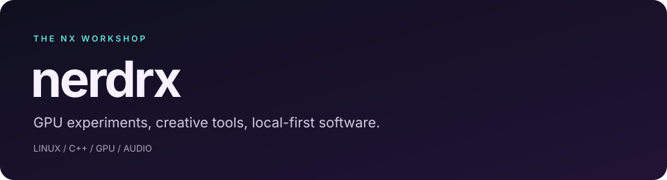

I build the **NX family**: graphics tools, GPU experiments, and local-first apps for my own hardware. Most of it exists because I wanted it to exist. Some of it is polished, some of it is "it works in the best ways... sometimes".

## what's here

**graphics & modelling**
- [nxsg](https://github.com/nerdrx/nxsg) — visual shader editor for VRChat avatars. Toon, PBR, fur, particles
- [quadforge](https://github.com/nerdrx/quadforge) — free auto-retopology for Blender, a Quad Remesher replacement
- [nx-loom](https://github.com/nerdrx/nx-loom) — authored quad topology: you draw the layout, it does the quads

**gpu & performance**
- [zVram](https://github.com/nerdrx/zVram) — poking at GPU memory beyond VRAM: telemetry, capacity probes, lossless compression
- [nx-warp](https://github.com/nerdrx/nx-warp) — Vulkan compute video codec for low-latency VR streaming. Research, not a product yet
- [wivrn-nx](https://github.com/nerdrx/wivrn-nx) — my working copy of the OpenXR streaming stack that warp runs on

**audio**
- [nxtakt](https://github.com/nerdrx/nxtakt) — native Linux DAW, Ableton-style clip launching, from-scratch C++20
- [pulsenx](https://github.com/nerdrx/pulsenx) — smartwatch heart rate → desktop, OBS, Discord, VRChat

**the rest**
- [nxclone](https://github.com/nerdrx/nxclone) — avatar clones, dance partners and afterimages for PC VRChat
- [nx-glow](https://github.com/nerdrx/nx-glow) — window colours spilling softly across your KDE wallpaper
- [nx-hub](https://github.com/nerdrx/nx-hub) — installs, updates and launches all of the above

## how this gets written

Most of this is written together with AI. It does the boring work and the grepping, I decide the architecture and what actually ships — nothing goes out that I can't explain from first principles. It's the fastest junior dev ever, with a speed thats hard to pass on BUT it occasionally lies with complete confidence...

---

🎮 [VRChat](https://vrchat.com/home/user/usr_416a2a8c-e537-43f2-adb5-509fffec8f58)
