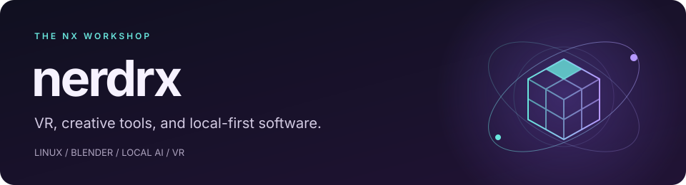
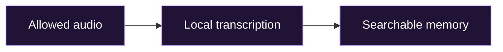
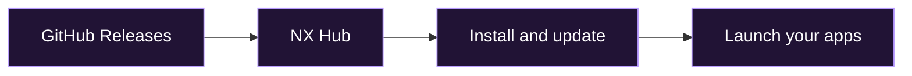

I build the **NX family**: expressive avatar materials, GPU experiments, and software you can run on your own hardware. This is the workshop—try a build, explore the research, or follow what comes next.

## NXSG

Build VRChat avatar materials by connecting nodes in Unity. Toon and PBR shading, fur, particles, procedural textures, and animated effects—with live previews as you work. Built for PC VRChat; mobile materials use a separate snapshot bake.

Connect the graph. Preview the material. Build for VRChat.

<table><tr>
<td width="50%"> Hologram study</td>
<td width="50%"> Pearl study</td>
</tr></table>

[**Get NXSG →**](https://nerdrx.github.io/nxsg/#install) · [First material](https://github.com/nerdrx/nxsg/blob/main/docs/QUICK_START.md) · [Source](https://github.com/nerdrx/nxsg)

## zVram

Explore GPU memory beyond local VRAM: Vulkan and HIP allocation tools, lossless idle snapshots, and managed buffers. **Experimental research**, with measured results and explicit compatibility limits.

Manager preview. Example allocations illustrate the interface; they are not a performance benchmark.

[**Explore zVram →**](https://github.com/nerdrx/zVram) · [Project website](https://nerdrx.github.io/zVram/)

## Warp

A GPU-native video codec exploring low-latency VR streaming with WiVRn NX. Follow the experiments, measured results, and tradeoffs. **Research prototype; no end-user download yet.**

Measured host packing time, lower is better. Fixed jobs improved the mean in both runs; p95 worsened in one. This default-off component experiment does not establish live VR latency. [Method and results](https://github.com/nerdrx/nx-warp/blob/88a6ff8bbbadb2e28415e88eadec00ee226944a2/bench/results/90fps-2026-10-05/continuous/zstd-jobs/README.md).

[**Explore Warp →**](https://github.com/nerdrx/nx-warp) · [Design paper](https://github.com/nerdrx/nx-warp/blob/main/docs/PAPER.md)

## Novum Xenium

Bring models, tools, projects, and chats together in a self-hosted AI workspace, with desktop and Android companions. Built on Odysseus, with NX improvements to usability, reliability, and integration.

Your workspace, models, and tools together. Dashboard shown with example activity.

[**Get started with Novum →**](https://github.com/nerdrx/novum-xenium#get-started) · [Desktop and Android releases](https://github.com/nerdrx/novum-xenium/releases)

## Recall

Local speech transcription, speaker identity, and searchable conversation history for VR and voice chat. Capture starts with the applications you explicitly allow.

Choose a local voice and tune its speaking speed.

[**Explore Recall →**](https://github.com/nerdrx/nx-recall) · [Linux download](https://github.com/nerdrx/nx-recall/releases/latest)

## Hub

One place to discover, install, update, and launch the NX apps. Downloads come from GitHub Releases, with checksum and signature verification where available.

Launch view with an example app stack.

[**Get NX Hub →**](https://github.com/nerdrx/nx-hub#start-here)

---

**Follow the builds.** Follow [@nerdrx](https://github.com/nerdrx), or choose **Watch → Custom → Releases** on a project for new builds. Tried something? Bug reports, screenshots, and specific feedback are welcome in that project's issues.
